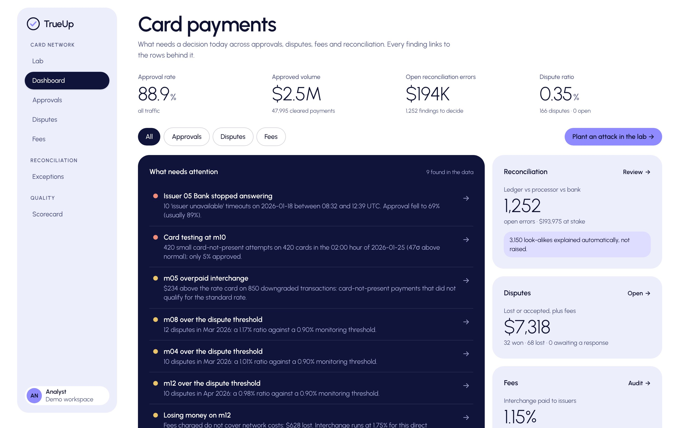
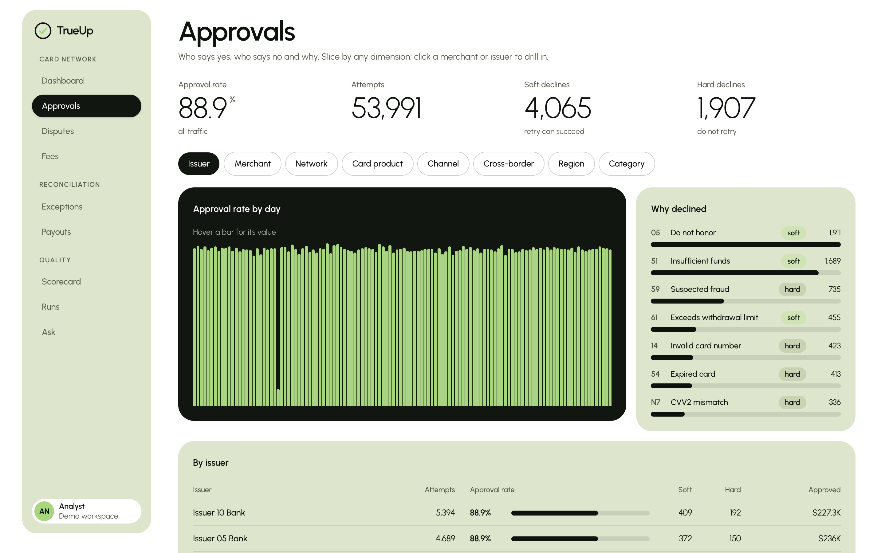
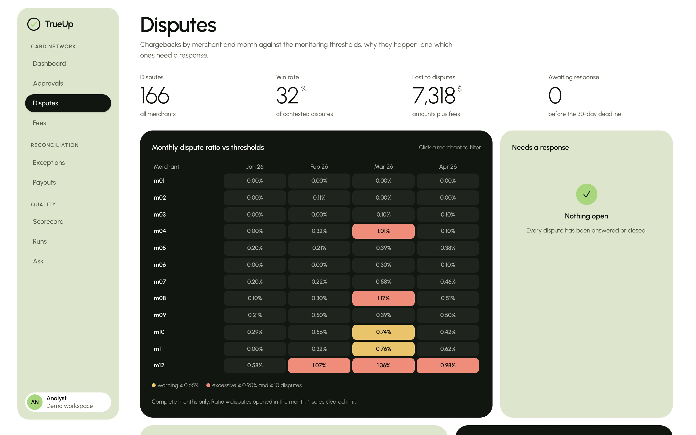
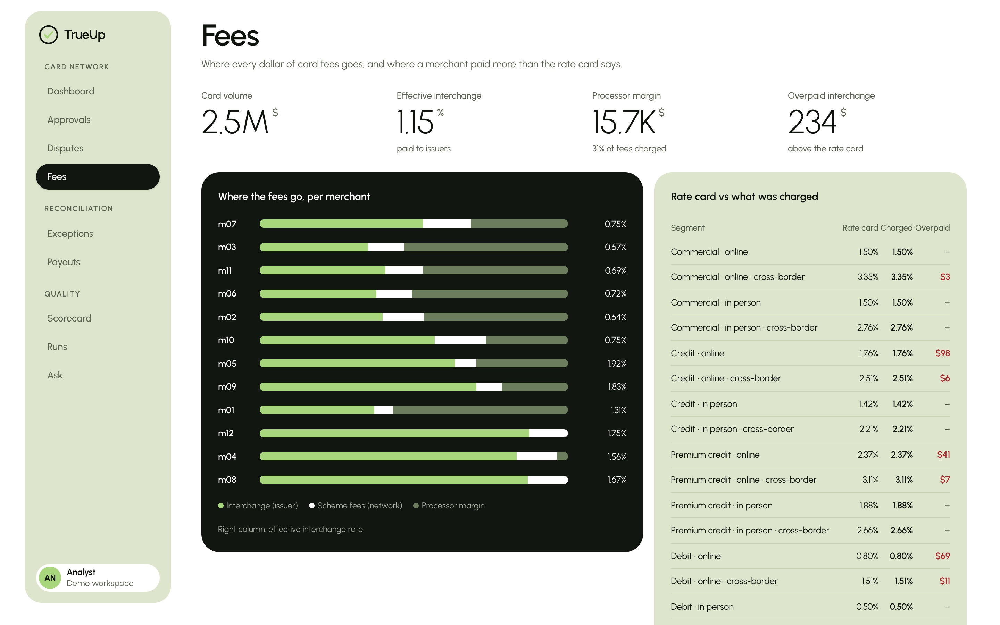
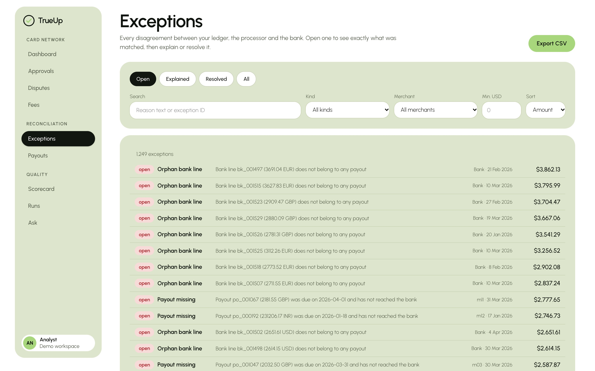

# TrueUp

**Card-payment analytics and reconciliation, graded against a known answer key.**

TrueUp invents a realistic card-payment business with known problems hidden in it, runs it through a production-style data pipeline, and shows what an analyst needs: who approves and who declines, which merchants breach dispute thresholds, where interchange is overpaid, and every disagreement between the ledger, the processor and the bank. Because the problems were planted, every finding is graded, not claimed.

The Python package and command are both `trueup` (`python -m trueup`). All data is synthetic.



| | |
|---|---|
|  **Approvals** by issuer, network, product, channel, region; decline reasons; drill-down |  **Disputes**: monthly ratio vs monitoring thresholds, reason codes, deadlines, dispute curves |
|  **Fees**: interchange, scheme fees and margin per merchant; rate-card audit |  **Exceptions**: ledger vs processor vs bank, explain or resolve with an audit trail |

## Card-network analytics
Around every captured payment the generator builds its card-network history ([NETWORK.md](docs/NETWORK.md)):

- **Authorizations** with ISO 8583-style response codes, soft-decline retries, 20 issuers, BIN ranges, debit/credit/premium/commercial products, card-present vs online, 3-D Secure.
- **Clearing** with interchange and scheme fees from a published rate card (regional caps, cross-border add-ons, category discounts), **refunds**, and **disputes** with Visa and Mastercard reason codes, 30-day response deadlines, representment outcomes and liability shift.
- **dbt marts** for approvals, decline reasons, dispute monitoring, dispute cohorts, fee economics, issuer health and authorization anomalies.

Four incidents are planted and recorded in the manifest, never loaded. Tests prove each is found exactly where it was planted and nowhere else:

| Planted | Found by |
|---|---|
| An issuer stops answering for six hours | `mart_issuer_health`: a burst of `91` responses on one issuer-day |
| A card-testing attack: hundreds of tiny online attempts on fresh cards | `mart_auth_anomalies`: hourly attempts scored against the merchant's own baseline |
| Interchange downgrades at one merchant | `fct_clearing`: the rate card rebuilt in SQL; a dbt test proves it matches every standard charge exactly |
| A high-risk merchant over the dispute threshold | `mart_dispute_monitoring`: complete months only, programme and cohort ratios |

The dashboard turns these into plain-language insights, and found one that was not planted: the processor loses money on two merchants whose interchange exceeds what they are charged.

## The lab: try to beat the detectors

`/lab` in the dashboard (`POST /api/lab/run`) lets anyone plant their own incidents: outage length, card-testing attack size, interchange downgrade share, dispute risk, history and volume, plus a seed. The API generates a fresh world from those settings in well under a second, runs the four detection rules in DuckDB, and grades each one against what was planted: found, missed, false alarm, or correctly quiet. Turn the attacks down far enough and the detectors miss, which shows where their thresholds sit.

## The idea in one paragraph
Three records of the same money never agree: the internal **ledger**, the **payment processor**, and the **bank**. Payments are booked twice, arrive late, settle in batches, get split, carry fees and rounding differences, and lose their references. Reconciliation finds where the three disagree and why. TrueUp measures how well it does that.

## Quick start
```bash
python -m venv .venv && . .venv/bin/activate
make install
make test
make demo          # world, daily deliveries, gated load, dbt, reconcile, scorecard

# the product
make demo-ui       # 120-day world through the real daily pipeline
make serve         # API on :8000        (one terminal)
make dashboard     # UI on :3000: landing page, then /dashboard
make uat           # browser acceptance tests
```

## Status
Delivery is planned in phases through to user acceptance testing and release. See [docs/ROADMAP.md](docs/ROADMAP.md).

| Phase | | |
|---|---|---|
| 0 Foundation | Done | repo, CI, tooling |
| 1 Synthetic world and answer key | Done | 13 defect classes, deterministic, property-tested |
| 2 Ingestion and warehouse | Done | schema contracts, quality gate, idempotent loads, dbt staging and marts |
| 3 Reconciliation engine | Done | five matching tiers, 14 finding classes, exception queue with audit trail |
| 4 Grader and benchmarks | Done | per-class precision and recall, frozen floors in CI, 1M-row speed test |
| 5 Orchestration and operations | Done | run ledger, resumable runs, backfills, alerts, freshness, lineage, Airflow DAG |
| 6 Product UI | Done | FastAPI + Next.js: landing page and ten screens, CSV export |
| 7 Natural-language questions | Done | validated read-only SQL, 45/45 evaluation, 68/68 unsafe requests refused |
| 8 Hardening | Done | audits in CI, security headers, WCAG 2.1 AA automated checks |
| 9 UAT | Automated done | 17/17 browser scenarios; manual pass and sign-off pending |
| 10 Release | Release candidate | hosted demo pending |
| 11 Card-network analytics | Done | authorizations, clearing, interchange, refunds, disputes; 7 marts; 4 planted incidents found by tests; 220 tests |

## Headline result
On a deliberately hard synthetic world (typo'd references that point at other real payments, look-alike round amounts, compound defects, missing bank references), the engine finds real errors with **0.999 precision and 0.994 recall**, raises **no false alarms on benign look-alikes**, and gets **100% of ledger links right**. The first version of the engine scored 0.561 precision on the same world. At one million ledger rows it reconciles in about 7 seconds. Full method, per-class tables, stability across seeds and the limits of the claim are in [docs/BENCHMARKS.md](docs/BENCHMARKS.md).

## Documents
- [Assistant](docs/ASSISTANT.md): how questions become safe SQL, and how it is graded
- [Operations](docs/OPERATIONS.md): runs, backfills, alerts, lineage
- [Security and accessibility](docs/SECURITY.md): what was checked and the known limits
- [Deploying on Vercel](docs/DEPLOY.md)
- [Changelog](CHANGELOG.md)
- [Benchmarks](docs/BENCHMARKS.md): accuracy, stability, speed, and what this does not show
- [Roadmap](docs/ROADMAP.md): every phase with deliverables and exit criteria
- [Architecture](docs/ARCHITECTURE.md): sources, keys and defect classes
- [UAT plan](docs/UAT.md): personas, 25 scenarios, severity scale, sign-off
