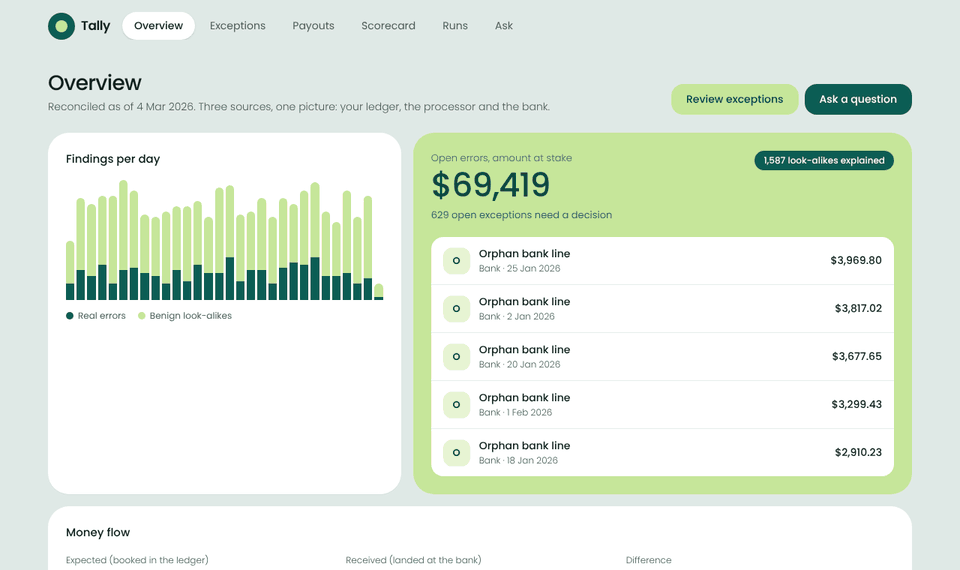

# Tally

Payments reconciliation that is **graded against a known answer key**.

Most reconciliation demos show a dashboard and ask you to trust it. Tally invents its own messy payment data, hides a known set of mistakes in it, and then scores the reconciliation engine like a test: how many real mistakes did it find, how many false alarms did it raise, and how accurate were its matches, class by class.

All data is synthetic. No real customer, bank or employer data is used anywhere.



## The idea in one paragraph
Three records of the same money never agree: the internal **ledger**, the **payment processor**, and the **bank**. Payments are booked twice, arrive late, settle in batches, get split, carry fees and rounding differences, and lose their references. Reconciliation finds where the three disagree and why. Tally measures how well it does that.

## Quick start
```bash
python -m venv .venv && . .venv/bin/activate
make install
make test
make demo          # world, daily deliveries, gated load, dbt, reconcile, scorecard

# the product
make demo-ui       # 60-day world through the real daily pipeline
make serve         # API on :8000        (one terminal)
make dashboard     # UI on :3000         (another terminal)
make uat           # browser acceptance tests
```

## Status
Delivery is planned in phases through to user acceptance testing and release. See [docs/ROADMAP.md](docs/ROADMAP.md).

| Phase | | |
|---|---|---|
| 0 Foundation | Done | repo, CI, tooling |
| 1 Synthetic world and answer key | Done | 13 defect classes, deterministic, property-tested |
| 2 Ingestion and warehouse | Done | schema contracts, quality gate, idempotent loads, dbt staging and marts |
| 3 Reconciliation engine | Done | five matching tiers, 14 finding classes, exception queue with audit trail |
| 4 Grader and benchmarks | Done | per-class precision and recall, frozen floors in CI, 1M-row speed test |
| 5 Orchestration and operations | Done | run ledger, resumable runs, backfills, alerts, freshness, lineage, Airflow DAG |
| 6 Product UI | Done | FastAPI + Next.js dashboard, six screens, CSV export |
| 7 Natural-language questions | Done | validated read-only SQL, 45/45 evaluation, 68/68 unsafe requests refused |
| 8 Hardening | Done | audits in CI, security headers, WCAG 2.1 AA automated checks |
| 9 UAT | Automated done | 14/14 browser scenarios; manual pass and sign-off pending |
| 10 Release | Release candidate | hosted demo, walkthrough and case study pending |

## Headline result
On a deliberately hard synthetic world (typo'd references that point at other real payments, look-alike round amounts, compound defects, missing bank references), the engine finds real errors with **0.999 precision and 0.994 recall**, raises **no false alarms on benign look-alikes**, and gets **100% of ledger links right**. The first version of the engine scored 0.561 precision on the same world. At one million ledger rows it reconciles in about 7 seconds. Full method, per-class tables, stability across seeds and the limits of the claim are in [docs/BENCHMARKS.md](docs/BENCHMARKS.md).

## Documents
- [Assistant](docs/ASSISTANT.md): how questions become safe SQL, and how it is graded
- [Operations](docs/OPERATIONS.md): runs, backfills, alerts, lineage
- [Security and accessibility](docs/SECURITY.md): what was checked and the known limits
- [Changelog](CHANGELOG.md)
- [Benchmarks](docs/BENCHMARKS.md): accuracy, stability, speed, and what this does not show
- [Roadmap](docs/ROADMAP.md): every phase with deliverables and exit criteria
- [Architecture](docs/ARCHITECTURE.md): sources, keys and defect classes
- [UAT plan](docs/UAT.md): personas, 25 scenarios, severity scale, sign-off
