# Operations runbook

## What runs
`python -m trueup run` (or the Airflow DAG) processes one day in four steps. Each step records its **input hash** in the run ledger and is skipped when it already succeeded for the same run with the same inputs.

| Step | Does | Fails how |
|---|---|---|
| `ingest` | Loads that day's delivery and the reference batch through the quality gate | A rejected batch is permanent: critical alert, no retry. Missing delivery is a warning. A quarantine spike is a warning. |
| `build` | dbt staging, marts and tests | Failing tests are permanent: critical alert, no retry. |
| `reconcile` | Runs the engine as of the processing date | Transient errors retry with backoff. |
| `publish` | Syncs the exception queue, publishes lineage, checks freshness | Stale sources raise warnings. |

## Commands
```bash
python -m trueup run --db data/warehouse.duckdb --batches data/batches --day 2026-01-05
python -m trueup backfill --db ... --batches ... --start 2026-01-01 --end 2026-01-31          # one run over the range
python -m trueup backfill --db ... --batches ... --start 2026-01-01 --end 2026-01-31 --per-day # day by day
python -m trueup runs --db ...        # the run ledger
python -m trueup alerts --db ...      # recent alerts
python -m trueup freshness --db ... --as-of 2026-01-05
python -m trueup lineage              # Mermaid graph (below)
```

## Guarantees (each is a test in `tests/test_ops.py`)
- **Idempotent:** running a finished day again does nothing.
- **Backfill equals a clean run:** processing three days one at a time gives a state hash-identical to one run over all three (raw, staging, marts and recon tables). Audit history in `ops.*` legitimately differs.
- **Resumable:** a run killed between steps resumes at the next step; ingest is not repeated and nothing is duplicated.
- **Retries:** transient failures retry with exponential backoff (2s, 4s, ...). Data problems never retry.
- **Alerts:** failures, rejected batches, missing deliveries, quarantine spikes, stale sources and SLA breaches are written to `ops.alerts` and, if `TRUEUP_ALERT_WEBHOOK` is set, posted there. A down webhook never breaks a run.

## Airflow
`orchestration/airflow/dags/trueup_daily.py` runs the same steps as four tasks. Airflow owns scheduling and retries (3 retries, exponential backoff, 30 minute timeout); `max_active_runs=1` because the warehouse file is single-writer; a data problem raises `AirflowFailException` so it fails fast.

Verified on Airflow 3.0.6 (Python 3.12): the DAG registers with no import errors, and `airflow dags test trueup_daily <day>` ran ingest, build, reconcile and publish for each of three days. The resulting warehouse was **hash-identical to a clean three-day run across 41 tables**.

Not verified here: a long-running scheduler and webserver.

## Freshness
Each source must have delivered within an allowed lag of the processing date (ledger, transactions and payouts: 2 days; bank: 4 days). A late source raises `freshness_stale`.

## Lineage
Generated from the dbt manifest plus the engine's reads (`ops.lineage` table, refreshed by `publish`). Every run also records which batches it loaded in `ops.run_inputs`.

```mermaid
graph LR
  marts_dim_fee_schedule[marts.dim_fee_schedule] --> marts_fct_processor_txn[marts.fct_processor_txn]
  marts_dim_merchant[marts.dim_merchant] --> marts_fct_processor_txn[marts.fct_processor_txn]
  raw_bank_lines[raw.bank_lines] --> staging_stg_bank_lines[staging.stg_bank_lines]
  raw_fee_schedule[raw.fee_schedule] --> staging_stg_fee_schedule[staging.stg_fee_schedule]
  raw_fx_rates[raw.fx_rates] --> staging_stg_fx_rates[staging.stg_fx_rates]
  raw_ledger_entries[raw.ledger_entries] --> staging_stg_ledger_entries[staging.stg_ledger_entries]
  raw_merchants[raw.merchants] --> staging_stg_merchants[staging.stg_merchants]
  raw_processor_payouts[raw.processor_payouts] --> staging_stg_processor_payouts[staging.stg_processor_payouts]
  raw_processor_txns[raw.processor_txns] --> staging_stg_processor_txns[staging.stg_processor_txns]
  staging_stg_bank_lines[staging.stg_bank_lines] --> marts_fct_bank_line[marts.fct_bank_line]
  staging_stg_fee_schedule[staging.stg_fee_schedule] --> marts_dim_fee_schedule[marts.dim_fee_schedule]
  staging_stg_fx_rates[staging.stg_fx_rates] --> marts_dim_fx_rate[marts.dim_fx_rate]
  staging_stg_ledger_entries[staging.stg_ledger_entries] --> marts_fct_ledger_entry[marts.fct_ledger_entry]
  staging_stg_merchants[staging.stg_merchants] --> marts_dim_merchant[marts.dim_merchant]
  staging_stg_processor_payouts[staging.stg_processor_payouts] --> marts_fct_payout[marts.fct_payout]
  staging_stg_processor_txns[staging.stg_processor_txns] --> marts_fct_payout[marts.fct_payout]
  staging_stg_processor_txns[staging.stg_processor_txns] --> marts_fct_processor_txn[marts.fct_processor_txn]
  marts_fct_ledger_entry[marts.fct_ledger_entry] --> recon_ref_candidates[recon.ref_candidates]
  marts_fct_processor_txn[marts.fct_processor_txn] --> recon_ref_candidates[recon.ref_candidates]
  recon_ref_candidates[recon.ref_candidates] --> recon_strong_links[recon.strong_links]
  recon_strong_links[recon.strong_links] --> recon_txn_links[recon.txn_links]
  marts_fct_ledger_entry[marts.fct_ledger_entry] --> recon_attr_links[recon.attr_links]
  marts_fct_processor_txn[marts.fct_processor_txn] --> recon_attr_links[recon.attr_links]
  recon_attr_links[recon.attr_links] --> recon_txn_links[recon.txn_links]
  recon_fuzzy_links[recon.fuzzy_links] --> recon_txn_links[recon.txn_links]
  recon_txn_links[recon.txn_links] --> recon_findings[recon.findings]
  recon_duplicate_entries[recon.duplicate_entries] --> recon_findings[recon.findings]
  marts_fct_bank_line[marts.fct_bank_line] --> recon_payout_links[recon.payout_links]
  marts_fct_payout[marts.fct_payout] --> recon_payout_links[recon.payout_links]
  recon_payout_links[recon.payout_links] --> recon_payout_summary[recon.payout_summary]
  recon_payout_summary[recon.payout_summary] --> recon_findings[recon.findings]
  marts_dim_fx_rate[marts.dim_fx_rate] --> recon_findings[recon.findings]
  recon_findings[recon.findings] --> ops_exceptions[ops.exceptions]

```


